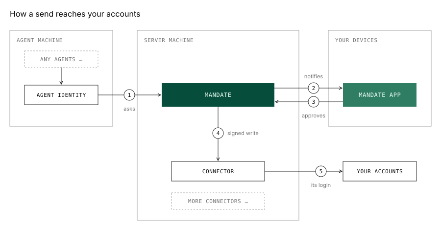

# mandate

mandate is a self-hosted gateway to your personal accounts for AI agents. It
is my compromise with the
[lethal trifecta](https://simonwillison.net/2025/Jun/16/the-lethal-trifecta/):

- Agents should never see your logins. Instead we use connectors on your own machine.
- Agents can read only what you grant, specifically for as long as you grant it.
- Anything an agent wants to send is stuck until you review and approve it on your device.

Every connector is an unofficial community plugin: the bundled ones aren't special, and you can write your own.

<picture>
  <source media="(prefers-color-scheme: dark)" srcset="docs/architecture-dark.svg">
  
</picture>

mandate answers agents and filters every read against your grants.
Connectors each hold one account and act only with your signature. You
approve in the mandate app on your phone or desktop, authenticating on that
device.

## Setup

On NixOS:

```nix
imports = [ inputs.mandate.nixosModules.default ];

services.mandate = {
  enable = true;
  connectors.whatsapp = { };
};
```

On any other Linux with systemd:

```sh
curl -fsSL https://github.com/adeci/mandate/releases/latest/download/install.sh | sh
sudo mandate setup
```

mandate listens on one HTTPS port; how you reach it is up to you. Open the
setup page and pair the mandate app on your phone or desktop.

## Agent identities

```sh
mandate login https://your-server
```

This creates an agent identity for the machine: every agent on it reaches
mandate through it. Open Add an agent in the app, then type the code it shows
when the command asks.

## Connectors

The bundled connectors are listed in [docs/connectors.md](docs/connectors.md).
To write your own, see the [connector protocol](docs/spec/connector.md).
